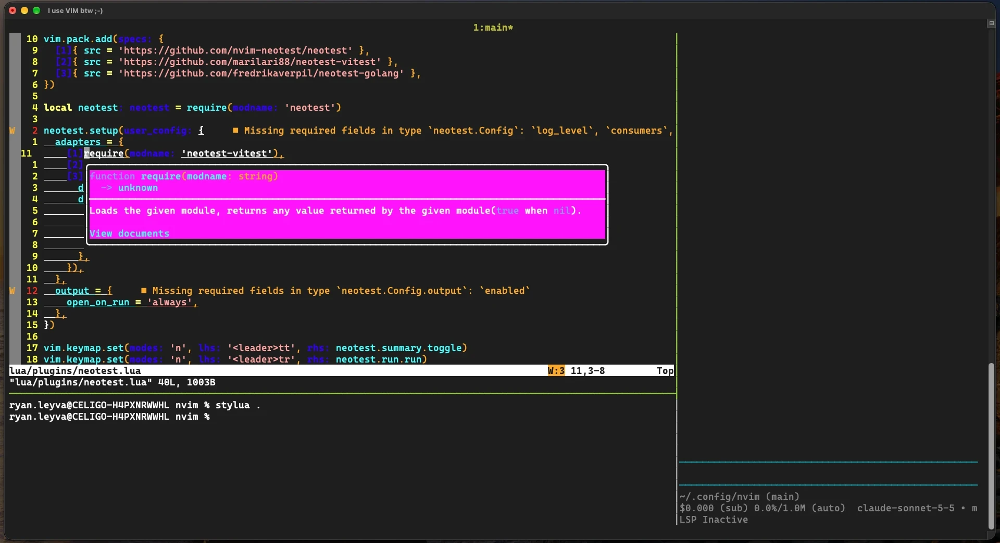

# dotfiles-macos



Personal macOS dotfiles managed with
[GNU Stow](https://www.gnu.org/software/stow/).

- Neovim 0.12+ with native `vim.pack` and `vim.lsp`, and tooling from
  [Mason](https://github.com/mason-org/mason.nvim)
- tmux config
- tmux session script

## Requirements

- [GNU Stow](https://www.gnu.org/software/stow/)
- [Neovim](https://neovim.io) 0.12 or later
- [tmux](https://github.com/tmux/tmux), for the tmux config and script
- [`git`](https://git-scm.com), [`node`](https://nodejs.org),
  [`go`](https://go.dev) and [`cargo`](https://doc.rust-lang.org/cargo/) for
  the tools that need them
- [`rustfmt`](https://github.com/rust-lang/rustfmt) from
  [rustup](https://rustup.rs), because Mason has no package for it
- A [Kulala](https://github.com/dont-be-evil-company/kulala.nvim) license
  token in `KULALA_CORE_LICENSE_TOKEN`, only if you use the HTTP client

## Install

```sh
git clone https://github.com/ryanjayleyva/dotfiles-macos ~/dotfiles-macos
cd ~/dotfiles-macos
stow .
```

## Layout

```bash
.config/nvim/             Neovim config, linked to ~/.config/nvim
.config/tmux/             tmux config, linked to ~/.config/tmux
docs/                     Documentation, not linked
scripts/                  Helper scripts
.stow-local-ignore        Files Stow must not link
```

### Neovim

```bash
init.lua                  Boot order, only requires
lsp/<name>.lua            One language server each, returns a table
lua/config/options.lua    Options
lua/config/keymaps.lua    Keymaps
lua/config/autocmds.lua   Autocmds, including the fixes that run on save
lua/core/lsp.lua          Enabled servers and diagnostics
lua/plugins/<name>.lua    One file per plugin
nvim-pack-lock.json       Plugin revisions
.stylua.toml              Formatter config
```

To add a language server, create `lsp/<name>.lua`, then add it to the Mason
table in `lua/plugins/mason.lua` and to the list in `lua/core/lsp.lua`.

### tmux

```bash
tmux.conf                 Entry point, sources the files below
options.conf              Options
terminal.conf             Terminal settings
bindings.conf             Key bindings
statusline.conf           Status line
```

## Docs

- [Neovim keymaps](docs/nvim-keymaps.md)
- [tmux keymaps](docs/tmux-keymaps.md)

## Credits

This config is mostly glue around these projects. Thanks to their authors and
contributors.

### Dotfiles

- [GNU Stow](https://www.gnu.org/software/stow/)

### Terminal

- [tmux](https://github.com/tmux/tmux)

### Editor

- [Neovim](https://github.com/neovim/neovim)

### Tooling

- [mason.nvim](https://github.com/mason-org/mason.nvim) and
  [mason-tool-installer.nvim](
    https://github.com/WhoIsSethDaniel/mason-tool-installer.nvim)
- [conform.nvim](https://github.com/stevearc/conform.nvim)
- [schemastore.nvim](https://github.com/b0o/schemastore.nvim)
- [plenary.nvim](https://github.com/nvim-lua/plenary.nvim)

### Editing

- [nvim-treesitter](https://github.com/nvim-treesitter/nvim-treesitter),
  [nvim-treesitter-context](
    https://github.com/nvim-treesitter/nvim-treesitter-context)
  and
  [nvim-treesitter-textobjects](
    https://github.com/nvim-treesitter/nvim-treesitter-textobjects)
- [nvim-cmp](https://github.com/hrsh7th/nvim-cmp) with
  [cmp-nvim-lsp](https://github.com/hrsh7th/cmp-nvim-lsp),
  [cmp-path](https://github.com/hrsh7th/cmp-path),
  [cmp-buffer](https://github.com/hrsh7th/cmp-buffer) and
  [cmp_luasnip](https://github.com/saadparwaiz1/cmp_luasnip)
- [LuaSnip](https://github.com/L3MON4D3/LuaSnip) and
  [friendly-snippets](https://github.com/rafamadriz/friendly-snippets)
- [nvim-surround](https://github.com/kylechui/nvim-surround)
- [nvim-ts-autotag](https://github.com/windwp/nvim-ts-autotag)
- [mini.pairs](https://github.com/nvim-mini/mini.pairs)
- [refactoring.nvim](https://github.com/ThePrimeagen/refactoring.nvim) and
  [async.nvim](https://github.com/lewis6991/async.nvim)

### Navigation

- [telescope.nvim](https://github.com/nvim-telescope/telescope.nvim) and
  [telescope-fzf-native.nvim](
    https://github.com/nvim-telescope/telescope-fzf-native.nvim)
- [vim-tmux-navigator](https://github.com/christoomey/vim-tmux-navigator)

### Git

- [gitsigns.nvim](https://github.com/lewis6991/gitsigns.nvim)

### Debugging and tests

- [nvim-dap](https://github.com/mfussenegger/nvim-dap),
  [nvim-dap-ui](https://github.com/rcarriga/nvim-dap-ui) and
  [nvim-nio](https://github.com/nvim-neotest/nvim-nio)
- [neotest](https://github.com/nvim-neotest/neotest) with
  [neotest-vitest](https://github.com/marilari88/neotest-vitest) and
  [neotest-golang](https://github.com/fredrikaverpil/neotest-golang)
- [rustaceanvim](https://github.com/mrcjkb/rustaceanvim)

### HTTP and databases

- [kulala.nvim](https://github.com/dont-be-evil-company/kulala.nvim)
- [vim-dadbod](https://github.com/tpope/vim-dadbod),
  [vim-dadbod-ui](https://github.com/kristijanhusak/vim-dadbod-ui) and
  [vim-dadbod-completion](
    https://github.com/kristijanhusak/vim-dadbod-completion)

## License

[MIT](LICENSE)
